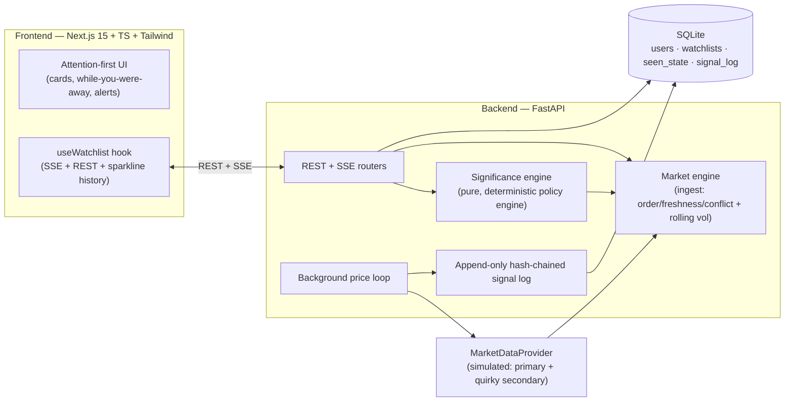

# Smart Market Watchlist

> Built for **Groww — Code 2026**. A watchlist that doesn't just show numbers — it tells you **what meaningfully changed since you last looked, and what deserves your attention now.**

Most watchlists are a wall of red and green. But the scarce resource for an investor isn't data — it's **attention**. So this app treats "what should I look at?" as the core problem and answers it with a deterministic, explainable engine.

Two ideas do the heavy lifting:

1. **"Meaningful" is volatility-normalised, not a flat %.** A 2% move is a big deal for a sleepy large-cap and pure noise for a jumpy small-cap. Each move is scored as a **z-score against that stock's own recent volatility** (scaled to the horizon of the move), so the app flags what's genuinely unusual *for that stock* — not just what's numerically large.
2. **"Since you last looked" is real, server-side state.** Your review checkpoint (baseline price + time) is stored per-user, so returning on any device shows a correct diff — and every material market event is written to an **append-only, hash-chained log** so the "while you were away" feed is *tamper-evident*.

<p align="center"><em>Prices are simulated (clearly labelled) behind a swappable provider interface — see <a href="#why-simulated-data">Why simulated data</a>.</em></p>

---

## What it does

- **Create & manage a watchlist** — search the NSE universe, add/remove, set per-symbol price alerts.
- **See the latest market info live** — prices stream over Server-Sent Events; freshness (live / delayed / stale) is shown honestly.
- **Return later and see what changed** — a "while you were away" summary ranks stocks by an **attention score** with a plain-English reason for each (`+3.2% since you looked — 2.6σ vs its usual move`, `Crossed your ₹2,900 alert`, `At a 52-week high`, `Gapped +3% at open`, `Volume 4× its usual pace`).
- **Trust the data** — stale, delayed, out-of-order and *conflicting* multi-source quotes are all detected and surfaced rather than silently shown as truth.

See **[SETUP.md](./SETUP.md)** for step-by-step run instructions on a fresh machine, **[DESIGN.md](./DESIGN.md)** for the full engineering rationale and trade-offs, and **[PITCH.md](./PITCH.md)** for the 100-word product pitch.

---

## Architecture



**One-line summary of the flow:** a background loop polls providers → the market engine ingests messy ticks into one trustworthy view (guarding order/freshness/conflict and maintaining rolling volatility) → the significance engine turns each quote + the user's baseline + alerts into scored, explained signals → the API serves a ranked view over REST and streams live updates over SSE → material events are appended to a hash-chained log.

> A deeper, annotated version of this diagram (with the exact decision points) is in **[DESIGN.md](./DESIGN.md)**.

---

## Tech stack

| Layer | Choice | Why |
|---|---|---|
| Backend | **FastAPI + SQLAlchemy 2.0 + SQLite** | Fast to build, typed, zero-config persistence a reviewer can run instantly; repository pattern → Postgres is a URL change. |
| Real-time | **Server-Sent Events** | Updates are one-way (server→client); SSE rides plain HTTP, auto-reconnects, and needs no WebSocket upgrade/proxy handling. |
| Auth | **JWT (passwordless, email)** | Per-user state across devices without storing passwords. |
| Frontend | **Next.js 15 + TypeScript + Tailwind** | Modern, typed, componentised; theme-aware. |
| Tests | **pytest** (40 tests) | Invariants of the significance engine, data-quality handling, and the hash chain. |

---

## Quick start

**Prerequisites:** Python **3.11+** (developed on 3.13) and Node **18+** (developed on 26).

### 1) Backend  → http://localhost:8137

```bash
cd backend
python3 -m venv .venv
source .venv/bin/activate            # Windows: .venv\Scripts\activate
pip install -r requirements.txt
uvicorn app.main:app --port 8137
```

Interactive API docs at **http://localhost:8137/docs**. On startup the app warms up volatility history and begins ticking a simulated market.

### 2) Frontend  → http://localhost:3000

```bash
cd frontend
npm install
npm run dev
```

Open **http://localhost:3000**, sign in with any email (no password — it's a demo), and add a few stocks. Try `RELIANCE`, `ZOMATO` (volatile), `HDFCBANK` with an alert, then leave and come back to see the "while you were away" summary.

> If your backend isn't on `localhost:8137`, set `NEXT_PUBLIC_API_BASE` (see `frontend/.env.local.example`).

### Run the tests

```bash
cd backend
pip install -r requirements-dev.txt
pytest                # 40 tests: significance, market engine, signal log, since-last-seen, API
```

---

## API reference

| Method | Path | Purpose |
|---|---|---|
| `POST` | `/api/auth/login` | Passwordless login/registration by email → session JWT |
| `POST` | `/api/auth/stream-token` | Exchange the session token for a short-lived, read-only **stream** token (for SSE) |
| `GET`  | `/api/instruments` | The tradable universe (for the add-symbol search) |
| `GET`  | `/api/watchlist` | The composed, ranked view (quotes + attention + since-you-looked + while-away) |
| `POST` | `/api/watchlist/items` | Add a symbol (optional `alert_above` / `alert_below`) |
| `PATCH`| `/api/watchlist/items/{symbol}` | Update / clear alerts |
| `DELETE`| `/api/watchlist/items/{symbol}` | Remove a symbol |
| `POST` | `/api/watchlist/seen` | Mark symbols reviewed (resets the "since you last checked" baseline) |
| `GET`  | `/api/activity` | Recent material events for your symbols |
| `GET`  | `/api/stream?token=…` | **SSE** live view stream (takes a **stream-scoped** token) |
| `GET`  | `/api/health` | Liveness + engine counters (public) |
| `GET`  | `/api/log/verify` | Recompute & verify the hash-chained activity log (authenticated) |

All endpoints except `login`, `instruments` and `health` require `Authorization: Bearer <token>`. The SSE stream instead takes a short-lived, read-only stream token as a query param (see Security below).

---

## Configuration (env vars)

| Var | Default | Meaning |
|---|---|---|
| `DATABASE_URL` | `sqlite:///./watchlist.db` | Any SQLAlchemy URL (e.g. Postgres). |
| `TICK_INTERVAL_SECONDS` | `2.0` | Simulated market tick cadence. |
| `SIM_SEED` | `42` | Deterministic simulator seed. |
| `JWT_SECRET` | dev placeholder | **Set this in production.** With `APP_ENV=prod`, the app refuses to start on the insecure default. |
| `APP_ENV` | `dev` | `prod` enforces a real `JWT_SECRET` at startup. |
| `TOKEN_TTL_HOURS` | `12` | Session-token lifetime. |
| `STREAM_TOKEN_TTL_SECONDS` | `1800` | Lifetime of the read-only SSE stream token. |
| `CORS_ORIGINS` | `http://localhost:3000` | Comma-separated allowed origins. |
| `ENABLE_PRICE_LOOP` | `1` | `0` disables the background loop (used in tests). |
| `NEXT_PUBLIC_API_BASE` | `http://localhost:8137` | Frontend → backend URL. |

The **operating points** that define "meaningful" (z-score thresholds, floors, staleness windows, alert weights) all live, commented, in [`backend/app/config.py`](./backend/app/config.py) — tune them without touching logic.

---

## Project structure

```
backend/
  app/
    config.py            # settings + the significance "operating points" (thresholds)
    market/
      provider.py        # MarketDataProvider interface, Quote, Freshness
      simulated.py       # deterministic simulator (primary + quirky secondary)
      engine.py          # ingest: order/freshness/conflict + rolling volatility
    significance.py      # THE core: pure, explainable "what is meaningful" engine
    signals_log.py       # append-only, hash-chained, verifiable event log
    services/            # ticker (runtime/loop), watchlist (view composition), accounts
    api/                 # auth, watchlist(+SSE), system routers
    main.py              # app wiring + background price loop
  tests/                 # 40 pytest tests
frontend/
  lib/                   # api client, types (mirror backend), format, useWatchlist hook
  components/            # WatchCard, WhileAwayPanel, AddSymbol, atoms, Header, ...
  app/                   # Next.js App Router (page.tsx, layout, globals.css)
SETUP.md                 # step-by-step run guide for a fresh machine (Windows-first)
DESIGN.md                # the explanatory doc — architecture, trade-offs, next steps
PITCH.md                 # 100-word product pitch
```

---

## Notes & honest limitations

<a name="why-simulated-data"></a>
- **Why simulated data.** There is no free, real-time Indian-equity feed a reviewer can run without keys or rate limits. Rather than ship something that breaks on first run, market data sits behind a `MarketDataProvider` interface with a **deterministic simulator** that also *injects* the messy conditions the brief asks about — staleness, delay, out-of-order ticks, and cross-source conflict — so that handling is real and testable. Swapping in a live vendor is one new class. Prices are labelled as simulated throughout the UI.
- **Security posture (demo).** Auth is passwordless-by-email (a deliberate demo choice — no passwords or secrets stored). Hardening already in place: the SSE stream uses a **short-lived, read-only stream-scoped token** (so the long-lived session token never rides in a URL), the app **fails fast** if started with `APP_ENV=prod` on the insecure default secret, token errors return a generic 401 (details logged server-side), and `/api/log/verify` is authenticated. Production would still add an OTP/OAuth login and an HttpOnly-cookie transport.
- **Scale.** In-memory shared quotes + per-symbol stats mean *N users watching a symbol cost one price object, not N*; event detection is O(symbols)/tick, user-specific scoring is O(items)/request. SQLite (WAL) is the current ceiling; the repository boundary makes Postgres a config change. Details and numbers in [DESIGN.md](./DESIGN.md).
- **Dependency advisories.** `npm audit` reports two build-time-only advisories inside **Next.js's own bundled `postcss`**; the only "fix" is a Next preview build, which is worse. They don't affect the running app. The critical `sharp`/libvips advisory *has* been patched.
# groww-code-watchlist
